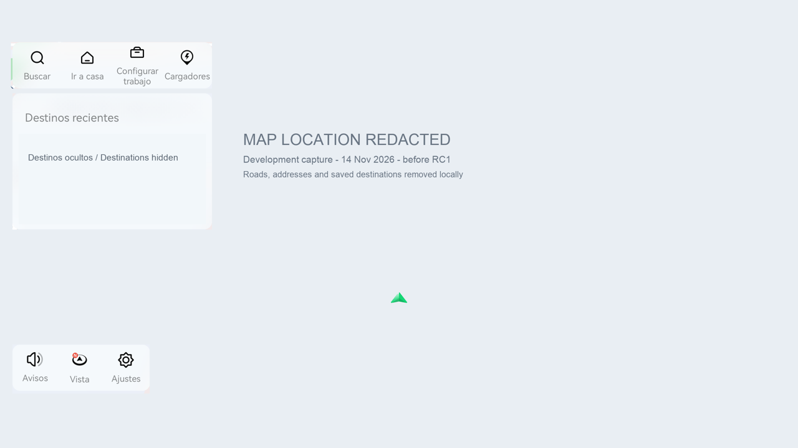
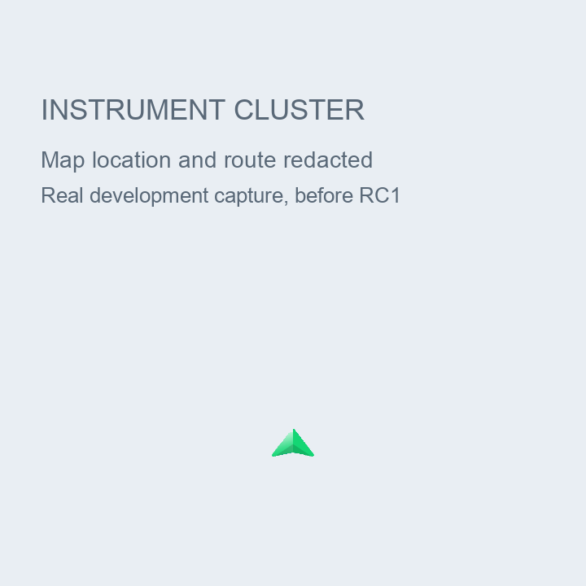

# Leapmotor C11 LATAM — RC1

[Castellano](README.md) · [English](README.en.md) · [Русский](README.ru.md) · [简体中文](README.zh-CN.md)

**A community project to make a Chinese-market C11's navigation useful in Latin America.** Establish reliable behavior on both displays first; then expand features and regional coverage without breaking that foundation.

## Why this project exists

The project grew out of its initiator's personal experience as the owner of an imported C11:

> After being scammed during the purchase/import of my car, I sought help. My experience with Leapmotor was a complete absence of support, empathy and even the most basic human consideration for my situation as a C11 owner in Latin America. This project is my response to that abandonment: recover the car's usefulness and share what we learn so other owners do not have to start from scratch.

This is the initiating owner's account and assessment. It does not identify Leapmotor as the party that committed the scam or claim that every owner had the same experience. The purpose is to turn frustration into shared tools, documentation and knowledge.

## Development vehicle

- **2024 Leapmotor C11, battery electric, 580 Premium, Chinese-market version.**
- Pilot vehicle used in **Uruguay**.
- Integration with the original **OEM AMap/AutoNavi 3.30** navigation, central display and instrument cluster.
- The vehicle contains Android and QNX components; this repository focuses on navigation and documenting regional adaptation.

This identifies the pilot platform, not compatibility with every C11 model year, trim or firmware.

## Current status: RC1

On **16 November 2026**, the owner confirmed that map behavior was working well and selected RC1 as the new baseline.

| Component | RC1 status |
|---|---|
| Central display | Owner-confirmed follow behavior: the vehicle stays at its anchor while the map moves. |
| Instrument cluster | Same behavior confirmed; the vehicle icon is shifted upward by 64 pixels. |
| Southern/western coordinates | The identified map-engine coordinate-validation correction is retained. |
| Spanish interface and speech | Existing adaptation work remains partial; this is not a claim of complete translation. |
| Project-added traffic and speed-camera features | **Disabled in RC1**, after restoring the working baseline. |
| Later home-arrival extension | Outside the restored baseline. |
| Full regression testing | **Pending.** Owner confirmation is not certification or coverage of every condition. |
| Other countries | Development targets, not advertised as already supported. |

**Working follow behavior on both displays is a release requirement.** New features must not bring back frozen maps or tiles.

This public edition contains original code and RC1 documentation. **It does not contain the complete modified APK, firmware, manufacturer libraries or map packages, and is not an RC1 installer.** [Technical status and limits](docs/STATUS.md).

## Final objective

Provide integrated, maintainable navigation for **every Latin American country**: appropriate maps, address and POI search, routing and rerouting, spoken guidance, consistent presentation across both displays, and regional language support. Spanish and Portuguese are priorities, without excluding other local needs.

The goal includes **map-assisted navigation**, using route, lane, maneuver, speed-limit and road-context information wherever data and compatibility can be verified. Longer term, investigate integration with map-based driving assistance where hardware and interfaces permit it. This is a research objective, **not an ADAS/NOA or autonomous-driving feature available in RC1**.

Traffic, speed cameras, charging locations and offline use belong to the roadmap, with suitable data and country-specific validation. Local connectivity and regional adaptation are additional research areas; eSIM/APN provisioning and migration to official global services have not been solved by this release.

[Countries and regional scope](docs/COUNTRIES.md) · [Roadmap](docs/ROADMAP.md)

## Images

These are real development captures from **14 November 2026, before RC1**, not evidence of behavior while driving. Geographic backgrounds, routes, saved destinations and labels were removed locally for privacy. They therefore show only interface portions and the vehicle glyph, not map detail. No fictional product screens were generated.

## Contribute and protect privacy

Reproducible bug reports, country/firmware testing, translations, suitable data sources and code review are welcome. Preserve RC1 as the reference and test locally first. See [contributing](CONTRIBUTING.md) and [architecture](docs/ARCHITECTURE.md).

The original cluster-anchor code and coordinate-validation assembly fragment are in `src/`. They require the appropriate OEM integration context; the assembly fragment is build-specific and not a standalone patch.

We publish no VINs, plates, personal phone numbers or email addresses, credentials, eSIM QR codes, private coordinates, trip logs or original screenshots. Public history is separate from the private recovery repository.

Original code and documentation are [MIT licensed](LICENSE). Third-party marks, interface and content retain their respective rights. Independent project; not affiliated with or endorsed by Leapmotor or AutoNavi.
