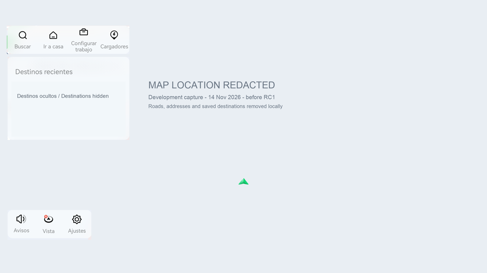
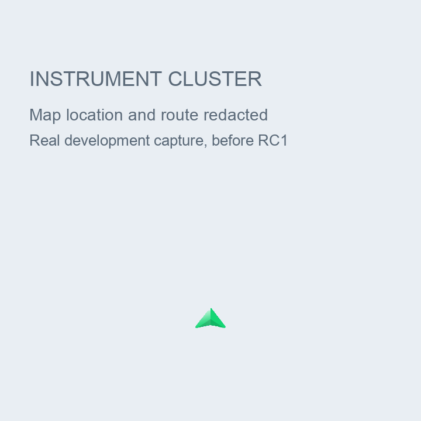

# Leapmotor C11 LATAM — RC1

[Castellano](README.md) · [English](README.en.md) · [Русский](README.ru.md) · [简体中文](README.zh-CN.md)

**Un proyecto comunitario para que un C11 de mercado chino pueda tener una navegación útil en Latinoamérica.** Primero, una base estable en las dos pantallas; después, ampliar capacidades y países sin perder lo que ya funciona.

## Por qué existe

El proyecto nace de la experiencia personal de su impulsor, propietario de un C11 importado:

> Después de haber sido víctima de una estafa en la compra/importación de mi coche, busqué ayuda. Mi experiencia con Leapmotor fue una falta total de soporte, empatía y de la más mínima humanidad ante mi situación como propietario de un C11 en Latinoamérica. Este proyecto es mi respuesta a ese abandono: intentar recuperar la utilidad del coche y compartir lo aprendido para que otros propietarios no tengan que empezar de cero.

Es el testimonio y la valoración del propietario que impulsa este trabajo. No significa que Leapmotor haya sido quien cometió la estafa ni que todos los propietarios hayan tenido la misma experiencia. El propósito es convertir esa frustración en herramientas, documentación y conocimiento compartido.

## En qué coche se trabaja

- **Leapmotor C11, año 2024, eléctrico puro, versión 580 Premium, mercado chino.**
- Vehículo piloto utilizado en **Uruguay**.
- Integración con la navegación original AMap/AutoNavi, versión OEM **3.30**, pantalla central y cuadro de instrumentos.
- Hay componentes Android y QNX en el vehículo; este repositorio se centra en la navegación y en documentar su adaptación regional.

Esto describe el vehículo piloto. No acredita compatibilidad con todos los C11, años, versiones o firmware.

## Estado actual: RC1

El **16 de noviembre de 2026**, el propietario confirmó que el comportamiento del mapa funciona bien y adoptó RC1 como nueva base:

| Elemento | Estado de RC1 |
|---|---|
| Pantalla principal | El propietario confirmó el seguimiento correcto: el coche conserva su anclaje y el mapa se desplaza. |
| Cuadro de instrumentos | Mismo comportamiento confirmado; icono desplazado 64 píxeles hacia arriba. |
| Coordenadas del hemisferio sur y oeste | Se conserva la corrección de validación identificada en el motor de mapa. |
| Interfaz y voz en castellano | Trabajo de adaptación existente, todavía parcial; no se presenta como traducción completa. |
| Tránsito y radares añadidos por el proyecto | **Desactivados en RC1**, tras volver a la base que funcionaba. |
| Llegada a casa añadida posteriormente | Fuera de la base restaurada. |
| Pruebas completas de regresión | **Pendientes.** La confirmación del propietario no equivale a una homologación ni a probar todas las condiciones. |
| Otros países | Objetivo de desarrollo; no se anuncian como ya compatibles. |

**El seguimiento en ambas pantallas es una condición fundamental para aceptar cambios.** No se incorporará una función nueva a costa de volver a congelar el mapa o las teselas.

Esta publicación contiene código propio y documentación de RC1. **No contiene la APK modificada completa, firmware, bibliotecas del fabricante ni paquetes de mapas, y no es un instalador de RC1.** [Estado técnico y límites](docs/STATUS.md).

## Objetivo final

Llegar a una experiencia de navegación integrada, mantenible y útil para **todos los países de Latinoamérica**: mapas adecuados, búsqueda de direcciones y puntos de interés, rutas y recálculo, instrucciones de voz, presentación coherente en ambas pantallas y localización para los idiomas de la región. El castellano y el portugués son prioridades, sin excluir otras necesidades locales.

La meta incluye **navegación asistida por mapa**: aprovechar información de ruta, carriles, maniobras, límites y contexto vial donde los datos y la compatibilidad permitan verificarla. A más largo plazo, investigar la integración con asistencia a la conducción basada en mapas cuando el hardware y sus interfaces lo permitan. Eso es un objetivo de investigación, **no una función ADAS/NOA ni conducción autónoma disponible en RC1**.

Tránsito, radares, cargadores y uso sin conexión forman parte de la hoja de ruta, con datos adecuados y pruebas por país. La conectividad local y la adaptación regional también son líneas de investigación; no se da por resuelto el aprovisionamiento eSIM/APN ni la migración de servicios oficiales.

[Países y alcance regional](docs/COUNTRIES.md) · [Hoja de ruta](docs/ROADMAP.md)

## Imágenes

Son capturas reales de desarrollo del **14/11/2026, anteriores a RC1**, no pruebas del comportamiento en movimiento. Para proteger la privacidad se retiraron localmente el fondo geográfico, las rutas, los destinos guardados y sus etiquetas. Por eso estas imágenes muestran sólo partes de la interfaz y el icono, no el detalle del mapa. No se generaron pantallas ficticias.

## Cómo contribuir

Son útiles los informes reproducibles de errores, pruebas por versión y país, mejoras de traducción, fuentes de datos adecuadas y revisión de código. Conservar RC1 como referencia y probar primero en local. [Contribuciones](CONTRIBUTING.md).

El código propio del ajuste vertical y el fragmento de validación de coordenadas están en `src/`. El primero necesita integrarse en un entorno OEM compatible; el segundo documenta una modificación específica de una compilación y no puede enlazarse o aplicarse sin conocer su contexto. [Arquitectura](docs/ARCHITECTURE.md).

## Privacidad y licencia

No publicamos VIN, matrículas, teléfonos, correos personales, credenciales, QR eSIM, coordenadas privadas, registros de viajes ni originales de las capturas. La edición pública tiene un historial Git independiente del respaldo privado.

Código y documentación originales bajo [licencia MIT](LICENSE). Las marcas, la interfaz y el contenido de terceros conservan sus derechos correspondientes. Proyecto independiente, sin afiliación ni respaldo oficial de Leapmotor o AutoNavi.
