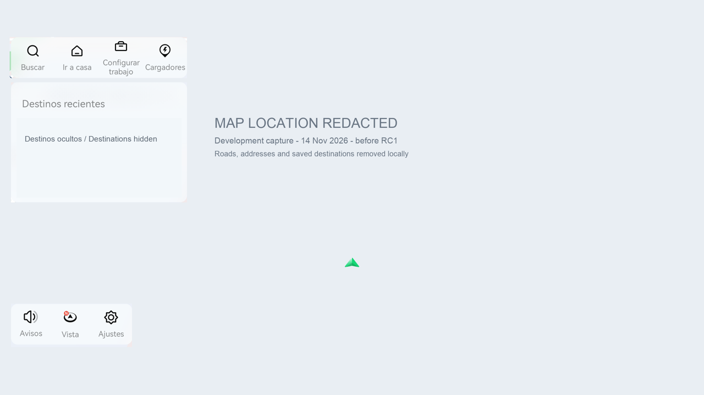
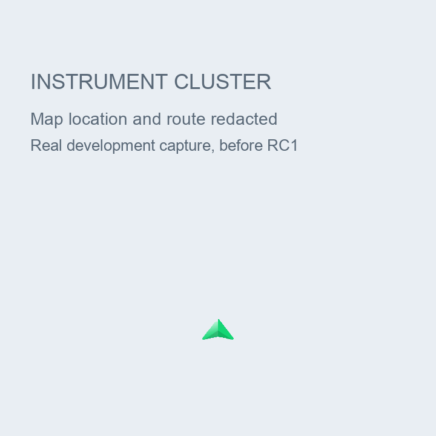

# Leapmotor C11 LATAM — RC1

[Castellano](README.md) · [English](README.en.md) · [Русский](README.ru.md) · [简体中文](README.zh-CN.md)

**Общественный проект, цель которого — сделать навигацию китайского C11 полезной в Латинской Америке.** Сначала нужна стабильная работа на обоих экранах, затем — новые функции и страны без потери этой основы.

## Почему появился проект

Проект возник из личного опыта его инициатора — владельца импортированного C11:

> После того как я стал жертвой мошенничества при покупке/импорте автомобиля, я обратился за помощью. Мой опыт общения с Leapmotor как владельца C11 в Латинской Америке — полное отсутствие поддержки, сочувствия и даже самого элементарного человеческого отношения к моей ситуации. Этот проект — мой ответ на ощущение, что меня бросили: вернуть автомобилю полезные функции и поделиться знаниями, чтобы другим владельцам не пришлось начинать с нуля.

Это рассказ и оценка владельца, начавшего проект. Из него не следует, что мошенничество совершила Leapmotor или что все владельцы столкнулись с тем же. Мы хотим превратить разочарование в общие инструменты, документацию и знания.

## Автомобиль для разработки

- **Leapmotor C11 2024 года, полностью электрический, 580 Premium, версия для китайского рынка.**
- Пилотный автомобиль используется в **Уругвае**.
- Интеграция со штатной навигацией **AMap/AutoNavi OEM 3.30**, центральным экраном и приборной панелью.
- В автомобиле есть компоненты Android и QNX; этот репозиторий посвящён навигации и документированию региональной адаптации.

Описание пилотного автомобиля не означает совместимость со всеми C11, комплектациями, годами выпуска или прошивками.

## Текущее состояние: RC1

**16 ноября 2026 года** владелец подтвердил, что карта работает хорошо, и выбрал RC1 новой базовой версией.

| Компонент | Состояние RC1 |
|---|---|
| Центральный экран | Владелец подтвердил правильное сопровождение: автомобиль остаётся в своей точке привязки, карта перемещается. |
| Приборная панель | Такое же поведение подтверждено; значок автомобиля поднят на 64 пикселя. |
| Координаты Южного и Западного полушарий | Сохранено исправление выявленной проверки координат в движке карты. |
| Испанский интерфейс и голос | Имеющаяся адаптация частичная; полный перевод не заявляется. |
| Добавленные проектом пробки и камеры скорости | **Отключены в RC1** после возврата к рабочей базе. |
| Позднее расширение прибытия домой | Не входит в восстановленную базу. |
| Полная регрессионная проверка | **Ещё не завершена.** Отзыв владельца не является сертификацией или проверкой всех условий. |
| Другие страны | Цели разработки; готовая поддержка не заявляется. |

**Правильное сопровождение на обоих экранах — обязательное условие принятия изменений.** Новые функции не должны возвращать зависание карты или тайлов.

Публичная версия содержит собственный код проекта и документацию RC1. **Полная изменённая APK, прошивки, библиотеки производителя и пакеты карт не публикуются. Это не установщик RC1.** [Техническое состояние и ограничения](docs/STATUS.md).

## Конечная цель

Интегрированная и поддерживаемая навигация для **всех стран Латинской Америки**: подходящие карты, поиск адресов и объектов, построение и пересчёт маршрутов, голосовые подсказки, согласованная работа двух экранов и региональные языки. Испанский и португальский — приоритеты, но другие местные потребности также важны.

Цель включает **навигацию с использованием картографических данных**: информацию о маршруте, полосах, манёврах, ограничениях скорости и дорожной обстановке там, где можно проверить данные и совместимость. В дальнейшем — исследовать интеграцию с системами помощи водителю на основе карт, если это позволяют оборудование и интерфейсы. Это направление исследований, **а не доступная в RC1 функция ADAS/NOA или автономного вождения**.

Пробки, камеры скорости, зарядные станции и автономная работа без сети входят в план развития с проверкой данных по странам. Местная связь и региональная адаптация также исследуются; настройка eSIM/APN и перенос на официальные глобальные сервисы этой версией не решены.

[Страны и региональный охват](docs/COUNTRIES.md) · [План развития](docs/ROADMAP.md)

## Изображения

Это реальные снимки разработки от **14 ноября 2026 года, до RC1**, а не доказательство работы в движении. Географический фон, маршруты, сохранённые пункты назначения и подписи удалены локально для защиты частной жизни. Поэтому показаны только части интерфейса и исходный значок автомобиля, без подробностей карты. Вымышленные экраны продукта не создавались.

## Участие, приватность и лицензия

Приветствуются воспроизводимые отчёты об ошибках, проверки по странам и прошивкам, переводы, подходящие источники данных и проверка кода. Сохраняйте RC1 как ориентир и сначала проверяйте изменения локально. [Участие](CONTRIBUTING.md) · [Архитектура](docs/ARCHITECTURE.md).

Код смещения значка и фрагмент проверки координат находятся в `src/`. Для них нужен соответствующий контекст интеграции со штатным ПО; ассемблерный фрагмент относится к конкретной сборке и не является самостоятельным патчем.

Мы не публикуем VIN, номера автомобилей, личные телефоны и адреса электронной почты, учётные данные, QR-коды eSIM, частные координаты, журналы поездок или исходные снимки. Публичная история Git отделена от частного репозитория восстановления.

Собственный код и документация распространяются по [лицензии MIT](LICENSE). Права на сторонние марки, интерфейс и материалы сохраняются за их владельцами. Независимый проект, не связанный с Leapmotor или AutoNavi и не одобренный ими официально.
