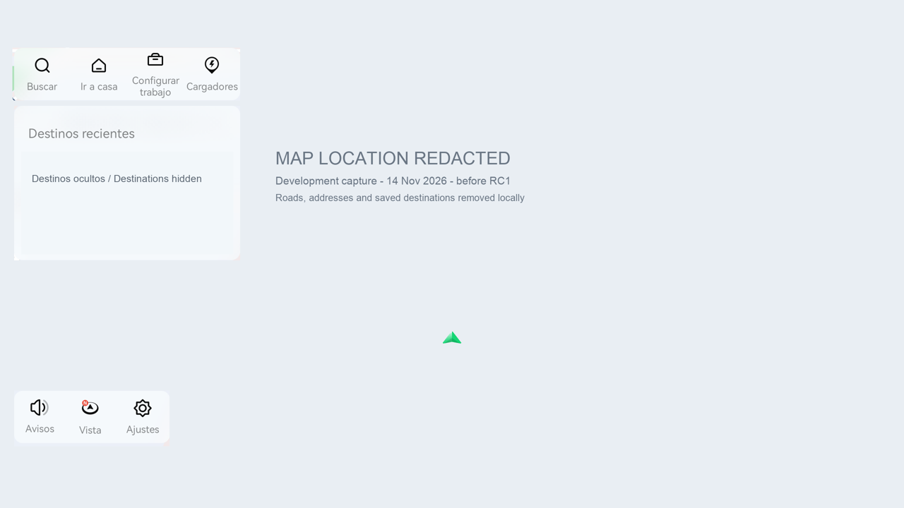
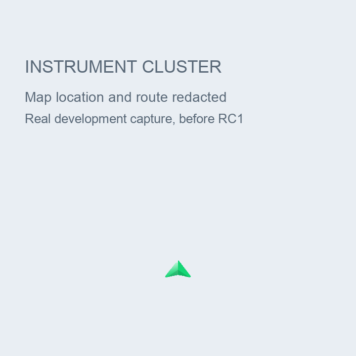

# Leapmotor C11 LATAM — RC1

[Castellano](README.md) · [English](README.en.md) · [Русский](README.ru.md) · [简体中文](README.zh-CN.md)

**这是一个社区项目，旨在让中国市场版本的零跑 C11 在拉丁美洲拥有实用的导航体验。** 先保证中控屏与仪表屏稳定工作，再逐步增加功能和地区支持，不能破坏已经可用的基础。

## 为什么要做这个项目

项目源于一位进口 C11 车主的亲身经历。发起人这样描述自己的感受：

> 在购车／进口过程中遭遇诈骗后，我曾寻求帮助。作为一名在拉丁美洲使用 C11 的车主，我与零跑接触的经历让我感到：没有支持，没有同理心，甚至缺乏面对我处境时最基本的人情味。这个项目是我对这种被抛下的感受的回应：努力恢复汽车的实用功能，并分享学到的知识，让其他车主不必从零开始。

这是项目发起人的个人经历与评价，并不指称诈骗由零跑实施，也不代表所有车主都有相同经历。项目希望把挫折转化为共享工具、文档和知识。

## 开发所用车辆

- **2024 款零跑 C11，纯电，580 Premium，中国市场版本。**“Premium”为车主对配置的称呼，不据此推定其他市场的同名配置完全一致。
- 试验车辆在**乌拉圭**使用。
- 基于原车 **AMap／高德 AutoNavi OEM 3.30** 导航，涉及中控屏和仪表屏。
- 车内有 Android 与 QNX 组件；本仓库重点是导航及其区域适配的研究记录。

这仅说明试验平台，不代表兼容所有 C11 年款、配置或固件。

## 当前状态：RC1

**2026 年 11 月 16 日**，车主确认地图表现正常，并决定把 RC1 作为后续开发的新基线。

| 项目 | RC1 状态 |
|---|---|
| 中控屏 | 车主确认跟随正常：车辆图标保持在锚点，地图随行驶移动。 |
| 仪表屏 | 同样的跟随行为已获车主确认；车辆图标上移 64 像素。 |
| 南半球／西半球坐标 | 保留了针对已发现的地图引擎坐标校验问题的修正。 |
| 西班牙语界面与语音 | 已有适配仍是部分完成，不能视为完整翻译。 |
| 项目新增的路况与测速摄像头功能 | 回退到可用基线后，**RC1 中已停用**。 |
| 后续增加的到家功能 | 不在恢复后的基线中。 |
| 完整回归测试 | **尚未完成。**车主确认不等于认证，也不意味着所有工况都已测试。 |
| 其他国家 | 属于开发目标，不宣称已经支持。 |

**两块屏幕上的正常地图跟随是接受后续改动的基本条件。** 不能为了新增功能而重新引入地图或瓦片冻结的问题。

本公开仓库包含项目原创代码和 RC1 文档。**不提供完整修改版 APK、固件、厂商库或地图数据包，也不是 RC1 安装器。**[技术状态与限制](docs/STATUS.md)。

## 最终目标

为**拉丁美洲所有国家**提供整合良好、便于维护的导航体验：适当的地图、地址和兴趣点搜索、路线规划与重新规划、语音引导、两块屏幕一致的显示，以及符合当地需要的语言支持。西班牙语和葡萄牙语是优先方向，但不排除其他本地语言需求。

目标包括**地图辅助导航**：在数据与兼容性能够得到验证的条件下，利用路线、车道、转向、限速及道路环境信息。更长远的研究方向，是在硬件和接口允许时探索与基于地图的驾驶辅助系统整合。这是研究目标，**不是 RC1 已具备的 ADAS／NOA 或自动驾驶功能**。

实时路况、测速摄像头、充电站和离线使用属于后续计划，需要逐国验证数据与实际表现。本地联网和区域适配也在研究范围内；本版本并未解决 eSIM／APN 配置或向官方全球服务迁移的问题。

[国家与地区范围](docs/COUNTRIES.md) · [开发路线图](docs/ROADMAP.md)

## 图片

下方为 **2026 年 11 月 14 日、RC1 之前**的真实开发截图，不能证明车辆行驶时的地图表现。为保护隐私，地理底图、路线、已保存目的地及其标签已在本地删除。因此，图片只保留部分界面与原始车辆图标，不展示地图细节；没有生成虚构的产品界面。

## 参与、隐私与许可

欢迎提交可复现的问题报告、不同国家／固件的测试结果、翻译、合适的数据来源及代码审查。请保留 RC1 参考基线，并先在本地验证。[参与指南](CONTRIBUTING.md) · [架构说明](docs/ARCHITECTURE.md)。

`src/` 中提供图标位置调整代码与坐标校验汇编片段。它们需要相应的原车软件集成环境；汇编片段针对特定构建，不是可以直接套用的独立补丁。

不公开 VIN、车牌、个人电话号码／邮箱、凭据、eSIM 二维码、私人坐标、行程日志或原始截图。公开 Git 历史与私人恢复仓库相互独立。

原创代码与文档采用 [MIT 许可证](LICENSE)。第三方商标、界面和内容的权利仍归各自权利人所有。本项目独立于零跑和高德，未获其官方背书。
